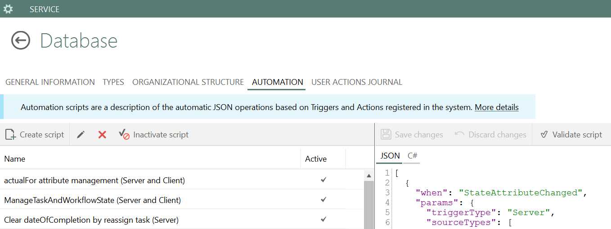

# rest_receiver

Приёмник уведомлений от ASCON Pilot о смене состояния заданий на изменение. Данные записываются в таблицу на MS SQL Server.

## Состав

| Файл | Назначение |
|------|------------|
| `trigger.json` | Триггеры серверного расширения Pilot |
| `activity.cs` | Активность `SendNotifications`, отправляющая запросы приёмнику |
| `src/` | Приёмник на Spring Boot (Java 21) |

Файлы `activity.cs` и `trigger.json` создаются в ASCON Pilot-myAdmin:



## Логика работы

| Переход состояния | Запрос | Действие в БД |
|-----------------------|--------|---------------|
| `assigned` → `agreed` | `POST /CREA` | вставка записи с `is_active = 1` |
| → `decline`, `done`, `deleted` | `POST /CHAR` | `is_active = 0` для записи с данным кодом |

Тело запроса (JSON, UTF-8):

```json
{ "code": "...", "project": "...", "pilotLogin": "..." }
```

Коды ответа: `200` при успехе, `400` при пустом `izm_code`, `403` для адреса не из списка разрешённых, `404` если `/CHAR` не нашёл запись, `500` при ошибке БД.


## Сборка

```bash
mvn package
```

Результат: `target/cpilotreceiver-<версия>.jar`.

## Запуск

Параметры задаются переменными окружения:

| Переменная | Назначение | По умолчанию |
|------------|------------|--------------|
| `DB_URL` | JDBC-строка подключения к MS SQL | `jdbc:sqlserver://sql_server_hostname;databaseName=pilot;...` |
| `DB_USER` | Пользователь БД | — |
| `DB_PASSWORD` | Пароль БД | — |
| `ALLOWED_IPS` | Адреса серверов Pilot через запятую; пусто — без ограничений | — |
| `PORT` | Порт HTTP | `8081` |
| `LOG_DIR` | Директория логов приложения и access-логов Tomcat | `logs` |

```bash
DB_URL="jdbc:sqlserver://sqlhost;databaseName=pilot;encrypt=true;trustServerCertificate=true;" DB_USER=pilot_receiver DB_PASSWORD=... ALLOWED_IPS=172.17.0.10 java -jar target/cpilotreceiver-1.4.0.jar
```

Для работы в продакшене `ALLOWED_IPS` необходимо задать: без него запросы принимаются с любого адреса.

## Настройка Pilot

В `trigger.json` в параметре `srvUrl` необходимо указать адрес и порт приёмника. Наличие параметра `deleState` переключает активность на запрос `/CHAR`.

